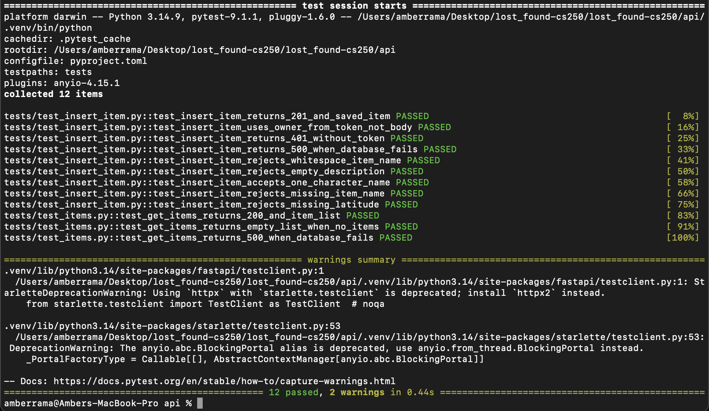
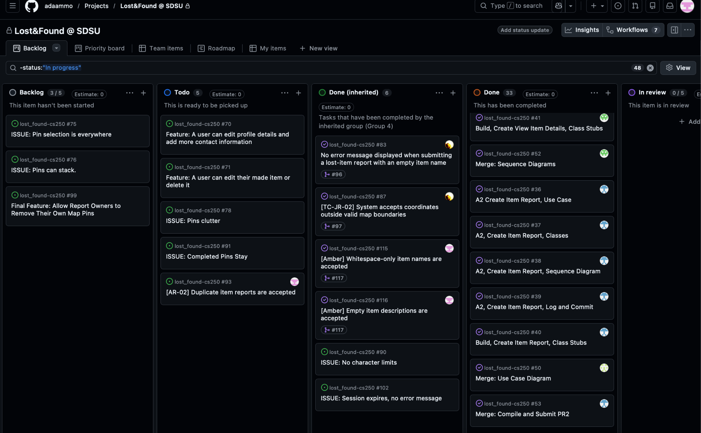

# Team 04

## Team Members
- Javier Rivera
- [Team Member 2]
- [Team Member 3]
- [Team Member 4]

---

# 1. Bug Triage Table

| Test Name | Bucket | Issue Link | Severity | Priority | Owner | Status |
|------------|------------|------------|------------|------------|------------|------------|
| TC-JR-02 | Code Bug | #87 | Major | Medium | Javier Rivera | Fixed |
| Empty Item Name Validation | Code Bug | #83 | Minor | Medium | Javier Rivera | Fixed |
| [Test] | [Code Bug / Test Bug / Missing Feature] | [Issue] | [Severity] | [Priority] | [Owner] | [Status] |
| [Test] | [Code Bug / Test Bug / Missing Feature] | [Issue] | [Severity] | [Priority] | [Owner] | [Status] |

---

# 2. Regression Log

## Full Suite Run Dates

- [Date]
- [Date]
- [Date]

## Regression Results

No regressions found.

OR

| Fix | Broken Test | Resolution |
|------------|------------|------------|
| [Issue #] | [Test Name] | [How it was fixed] |

---

# 3. Final Test Run

## Final Test Run Screenshot

## Remaining Failures

### Example

| Test | Reason |
|------------|------------|
| None | All tests passing |

OR

| Test | Reason |
|------------|------------|
| [Test Name] | [One-line explanation] |

---

# 4. Feature Decision

## Feature Name

Allow Report Owners to Remove Their Own Map Pins

## User Story

As a user, I want to remove my own map pins, so that outdated or unnecessary reports no longer appear on the map.

## Why We Chose This Feature

Our team selected this feature because users currently have the ability to create reports but do not have a way to remove their own reports after the item has been recovered or the report is no longer needed, because without this it leads to clusters of pins on the map.

## Ownership

| Team Member | Responsibility |
|------------|------------|
| Javier Rivera | Front-End Button Implementation |
| Team Member 2 | [Task] |
| Team Member 3 | [Task] |
| Team Member 4 | [Task] |

## Test Cases

### Test Case 1

Signed in users can successfully remove their own map pin.

Expected Result:

The report pin is removed from the map.

### Test Case 2

A non-owner attempts to remove another user's map pin.

Expected Result:

Removal is denied. (Also, there will be no button present, so the attempt can only be negative.)

---

# 5. Board Snapshot

---

# 6. Sprint Summary

This sprint we focused on bug identification, triage, bug fixes, and regression testing following canvas instructions. The Issues that we discovered during verification and validation (PR3) were categorized and tracked through GitHub Issues, and the project board. Several bugs were fixed and tested to confirm that existing functionality continued to operate correctly after merging the fix. 
The selected feature for the next sprint is to allow users who made reports to have the ability remove their own map pins. Our team should prioritize implementing that feature while continuing to test & monitor for any newly discovered defects as we progress.