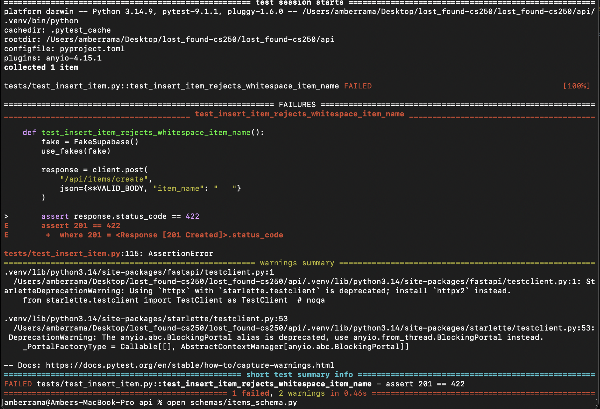
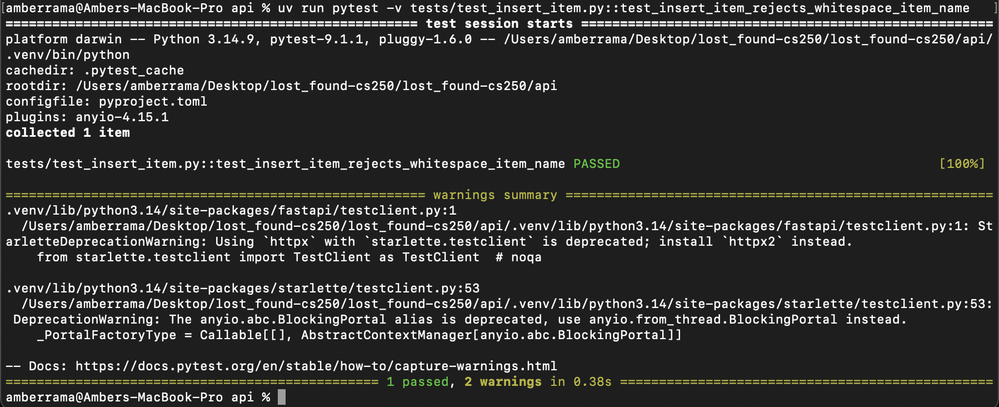
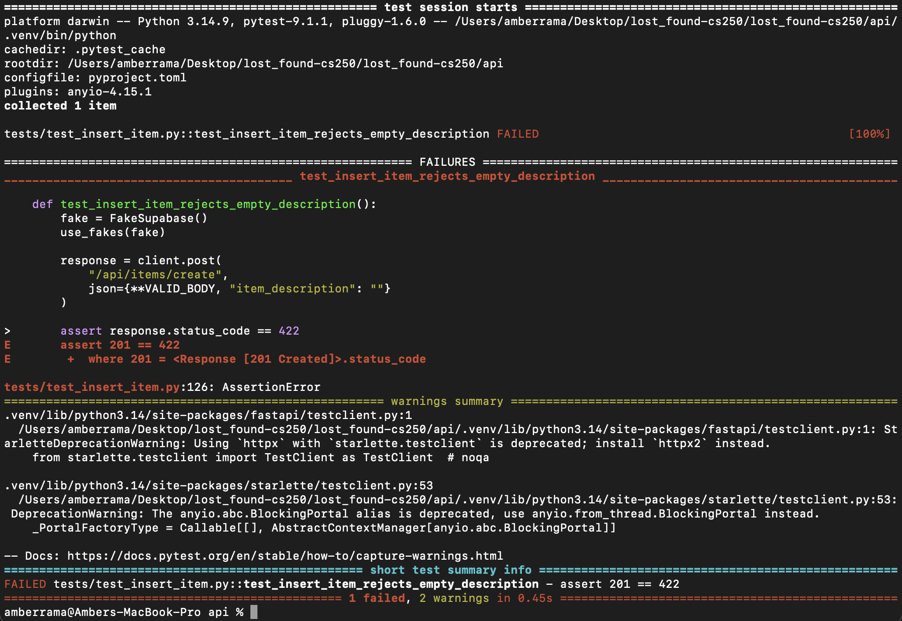
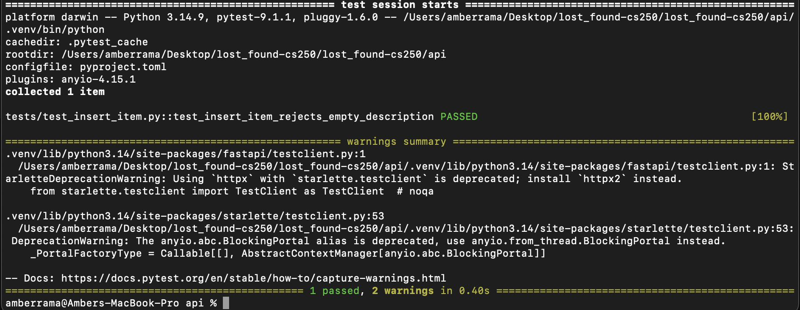
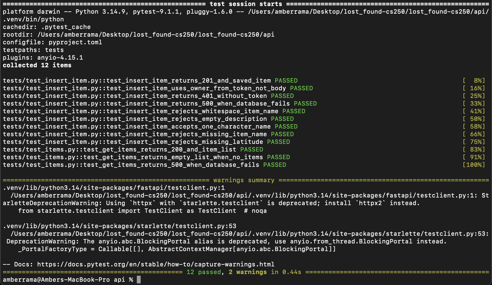

# Amber Rama

## Issue #115: Whitespace-only item names are accepted

Issue: https://github.com/adaammo/lost_found-cs250/issues/115

PR: (https://github.com/adaammo/lost_found-cs250/pull/117)

This was a code bug because the test correctly expected the API to reject a whitespace-only item name, but the original code returned HTTP 201 and created the item. I fixed it by adding validation that rejects names containing only whitespace.

### Before

### After

## Issue #116: Empty item descriptions are accepted

Issue: https://github.com/adaammo/lost_found-cs250/issues/116

PR: https://github.com/adaammo/lost_found-cs250/pull/117 

This was a code bug because the test correctly expected an empty description to return HTTP 422, but the original code returned HTTP 201. I fixed it by requiring the item description to contain at least one character.

### Before

### After

## Final test run

The final backend test run passed all 12 tests with two dependency warnings.

## AI disclosure

I used Claude to help organize this report.