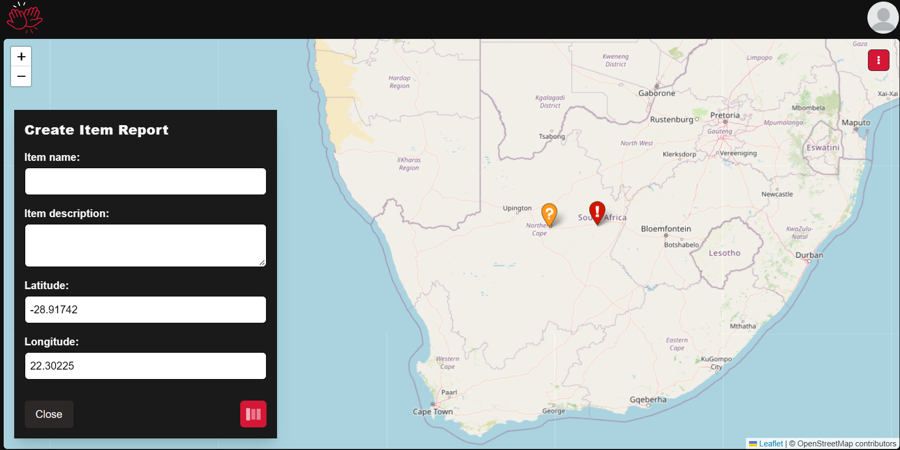

# Javier Rivera

## Issue #83 - No error message displayed when submitting a lost-item report with an empty item name

### Issue Link
[[Click GitHub Issue #83 Link Here!](https://github.com/adaammo/lost_found-cs250/issues/83)]

### Pull Request Link
[[Click Pull Request Link Here](https://github.com/adaammo/lost_found-cs250/pull/96)]

### Before Screenshot

### After Screenshot

### Classification

Code Bug

### How I Knew

The application originally allowed a user to attempt a submission report with a blank item name, but the app rejects it without provide any feedback and explaining to the user why there invalid submission would not proceed. Also, after discussion with professor, during PR3, they have confirmed that this issue is still considered a bug.

### Fix Summary

So, I added front-end validation to the submission button logic for creating an Item Report. First, once the form is submitted, the validation checks whether the item name is empty or contains only spaces. If the input is invalid, a pop up message will notify the user and Further interaction is prevented until the user acknowledges the notification, by clicking the "OK" button.

### Regression Testing

I was able to still submit a valid report after implementing the fix. The report was successfully created and the pin was displayed on the map, confirming that the functionality of normal report submission behavior still functions correctly. Also, the item is labeled with the Github issue, #83, in the item name for the regression test and in description my regression test statement is displayed for review purposes.

### AI Disclosure

Google Ai was used to assist with reviewing the assignment requirements, clarifying Browser & React behavior and methods, and setting template for MD file.

---

