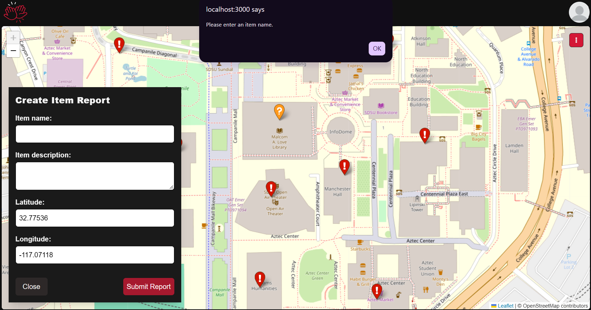

# Javier Rivera

## Issue #83 - No error message displayed when submitting a lost-item report with an empty item name

### Issue Link
[[Click GitHub Issue #83 Link Here!](https://github.com/adaammo/lost_found-cs250/issues/83)]

### Pull Request Link
[[Click Pull Request Link Here](https://github.com/adaammo/lost_found-cs250/pull/96)]

### Before Screenshot

### After Screenshot

### Classification

Code Bug

### How I Knew

The application originally allowed a user to attempt a submission report with a blank item name, but the app rejects it without provide any feedback and explaining to the user why there invalid submission would not proceed. Also, after discussion with professor, during PR3, they have confirmed that this issue is still considered a bug.

### AI Disclosure

Google Ai was used to assist with reviewing the assignment requirements, clarifying Browser & React behavior and methods, and setting template for MD file.

---

## Issue #87 - System accepts coordinates outside valid map boundaries

### Issue Link
[[Click GitHub Issue #87 Link Here](https://github.com/adaammo/lost_found-cs250/issues/87)]

### Pull Request Link
[[Click Pull Request Link Here](https://github.com/adaammo/lost_found-cs250/pull/97)]

### Before Screenshot

[Issue 87 Before](screenshots/javier_rivera_issue87_before.png)

### After Screenshot

[Issue 87 After](screenshots/javier_rivera_issue87_after.png)

### Classification

Code Bug

### How I Knew

The application originally allowed users to select location coordinates outside of the SDSU area, where users were able to produce lost reports in Africa or other parts of the world.

### AI Disclosure

Google Ai was used to assist with reviewing the assignment requirements, clarifying Browser & React behavior and methods, setting template for MD file, helping me find the latitude & longitude coordinates of the preferred SDSU area for where I wanted to provide the coordinate boundaries, via map photo cut out I provided for Google maps.