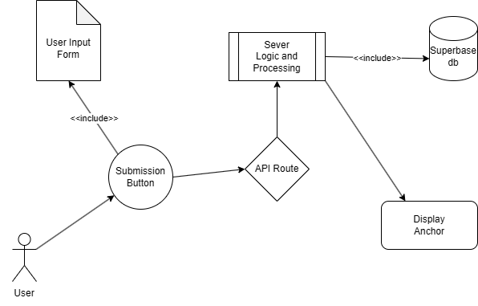

# System Map

## Team Information

**Team Name:** pressPlay() - Group 4

**Inherited Project:** Lost & Found - Group 3

| Role | Name |
|--------|--------|
| Product Analyst | Trystan |
| Architect | TBD |
| Frontend Tracer | Javier |
| Backend Tracer | TBD |

---

# Part 1: Purpose

The lost and found website is meant for anyone who lost or found an item on the SDSU campus so 
that they can return the item to the rightful owner or find their lost item.

## User Action Traced

TRACING: “Submit/Close lost item” button

---

# Part 2: Architecture Diagram

## Architecture Summary

User submits item information through the CampusMap interface. The request is processed through the FastAPI client and backend before being stored in Supabase. Data is then returned to the frontend and displayed on the map.

---

# Part 3: Trace the Click

| Step | Layer | File and Function | Data In / Data Out | Notes |
|--------|--------|--------|--------|--------|
| 1 | Frontend | CampusMap.tsx → insertItemReport() | Form data → POST request | None |
| 2 | API Route | fastapiClient.ts → insertItemReport() | Form data → FastAPI | More complicated API preparation than expected |
| 3 | Backend Logic | types.ts → ItemCreate | Item data object → FastAPI | None |
| 4 | Database | Supabase | FastAPI → Database | Need clarification on Supabase/FastAPI relationship |
| 5 | Response Back | CampusMap.tsx | Supabase → Frontend | None |

---

# Part 4: Reality Check and Open Questions

## Handoff Documentation Issues

- No mismatches were identified between the code and documentation.

## Questions for the Original Team

### Question 1 (Design)

Why was supabase used with fastapi?, A: Supabase handles only the user backend since it's 
faster. 

### Question 2 (Design)

Clarification on Front-end inputs and how they’re stored in the database? 

### Question 3 (Intent)

Where is the anchor placement and how do we edit? 

---

AI use for GitHub Template format.